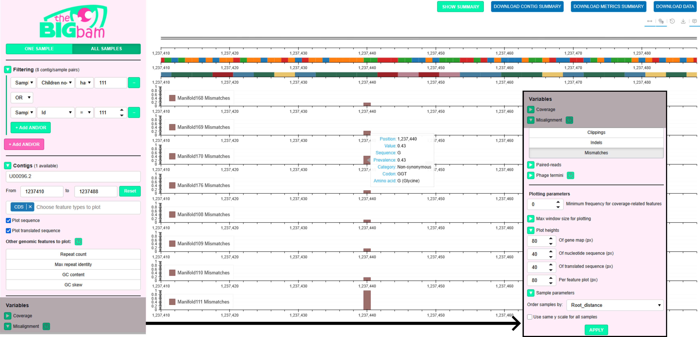
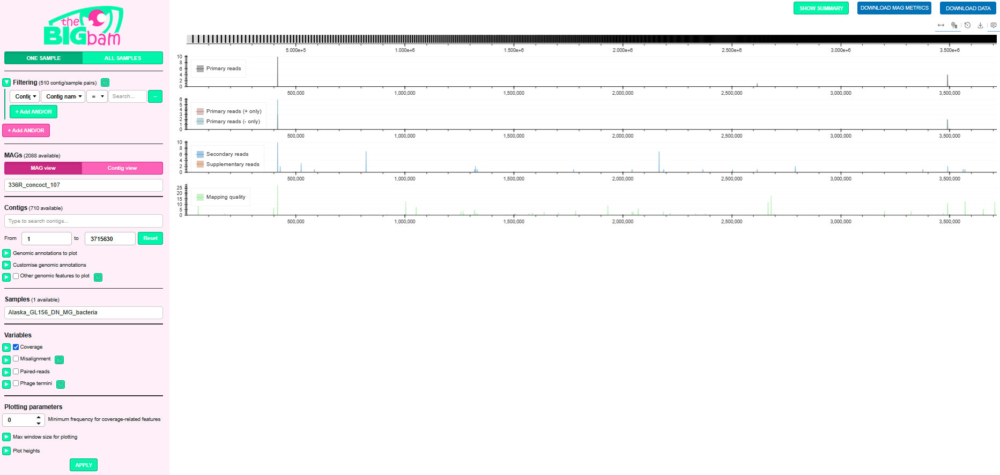

# Applying theBIGbam to real projects?

## Use case 1: medium dataset, 1 contig, 252 samples

The temporal dataset comes from a microbial evolution experiment in which *Escherichia coli* K-12 was grown on an agar megaplate with increasing concentrations of trimethoprim [(Baym et al. 2016)](https://www.science.org/doi/10.1126/science.aag0822).

252 samples were collected and sequenced with paired-end short-reads, allowing reconstruction of evolutionary trajectories with mutations and selections happening along the expanding microbial front.

So we have:

- **1 contig** (*E. coli* K-12): we download the associated FASTA sequence and GenBank annotation file from NCBI (U00096.2)

- **252 samples**: we can download them using the SRA ([prefetch and fasterq-dump commands](https://github.com/ncbi/sra-tools/wiki/08.-prefetch-and-fasterq-dump))

### Mapping

We first need to perform an alignment. The bacterial chromosome is complete (one circular contig) so we can use the circular mode of theBIGbam mapping:

```shell
mkdir bams_circular
cat samples.csv | while read -r read1 read2; do
    thebigbam mapping-per-sample -t 4 --circular -r1 ${read1} -r2 ${read2} -a Ecoli_K12_U00096.2.fasta -o bams_circular/${read1/_1.fastq/.bam}
done
```

samples.csv contains one row per sample, with two columns specifying the paths to the paired FASTQ files

### Calculate

To provide context to our read mapping, we annotate the bacterial chromosome using [Bakta](https://github.com/oschwengers/bakta):

```shell
bakta --db <path_to_bakta_db> --output bakta_Ecoli_K12_U00096.2 --prefix Ecoli_K12_U00096.2 --complete --threads 10  Ecoli_K12_U00096.2.fasta
```

**Warning:** The `--keep-contig-headers` option is essential to prevent Bakta from renaming contigs. The reference names in your annotation files must exactly match those used in the BAM files.

Then we provide the directory containing the alignment files we produced (bams_circular) and the Bakta .gbff file to the calculate command:

```shell
thebigbam calculate -t 8 -b bams_circular -g bakta_Ecoli_K12_U00096.2/Ecoli_K12_U00096.2.gbff -o ecoli_megaplate.db
```

The command takes 10 minutes and 19 GB of RAM to compute with 8 threads. The final DuckDB database takes 2.2 GB to compare with the initial 25 GB of alignment files and 6 MB of annotations (11x compression factor).

### Exploration

We complement the database with extra metadata for each sample to know the ancestors and descendants of each sample on the megaplate:

```shell
thebigbam add-sample-metadata --db ecoli_megaplate.db --csv metadata_samples.csv
```

The metadata file looks like:

```csv
Sample,Instrument,Bases,Experiment,Isolate,Id,Parent,Root,Root_distance,Parent_nodes,Children_nodes,Terminal_nodes,MIC_color,MIC_level,MIC_approximative
Manifold222,Illumina HiSeq 2500,152393400,Multistep,Manifold222,222,217,187,3,"217;193;187","223;224;226","223;224;226",turquoise,5,100
Manifold223,Illumina HiSeq 2500,137961800,Multistep,Manifold223,223,222,187,4,"222;217;193;187",,223,blue,4,30
```

When serving the database to a localhost, that allows to pick any evolutionary path and see how the *E. coli* evolved throughout this path:

```shell
thebigbam serve --db ecoli_megaplate.db
```

On the figure below, we selected the evolutionary path leading to node 111 in the **Filtering** section of the **All Samples** mode. We picked the Mismatches variable as the plotted variable to see the mismatches appearing and disappearing along this path. To make it easily readable, we order samples by Root_distance in the **Plotting parameters**: 



On the figure, we zoomed in around position 1,237,440 to see the prevalence of a mismatch across generations. **When zooming, we need to re-click APPLY to refresh the plots**. If zooming close enough, as here, we see the sequence and codons appearing below the gene map on the top tracks.

---

## Use case 2: large dataset, 50k contigs, 192 samples

We tested the tool on an in-house large dataset of **192 glacier-fed stream metagenomes** collected worldwide. We first assembled all metagenomes using MEGAHIT and identified all viral contigs > 10 kbp using geNomad. We combined the viral contigs found in all samples and dereplicated them using scripts from CheckV (at 95% identity and 75% coverage). We ended up with **50,043 viral contigs > 10 kbp** (mostly viruses of bacteria a.k.a. bacteriophages).

### Mapping

We perform the mapping of each sample against all viral contigs. Complete phage genomes are circular during an infection cycle so it makes sense to use theBIGbam circular mode: 

```shell
mkdir bams_circular
cat samples.csv | while read -r read1 read2; do 
    sbatch -q serial -N 1 -n 1 -c 8 -t 10:00:00 --wrap="thebigbam mapping-per-sample -t 16 --circular -r1 ${read1} -r2 ${read2} -a viral_contigs_bigger_than_10kbp.fasta -o bams_circular/${read1/_1.fastq/.bam}"
done
```

Considering the size of each sample, it is better practice to perform the mapping on a HPC cluster using slurm or an equivalent as done here.

### Calculate

We annotate all viral contigs using [pharokka](https://github.com/gbouras13/pharokka):

```shell
sbatch -q serial -N 1 -n 1 -c 20 -t 20:00:00 --wrap="pharokka.py --meta -d <path_to_pharokka_db> -i viral_contigs_bigger_than_10kbp.fasta -o pharokka_viral_contigs_bigger_than_10kbp -t 20"
```

Then we provide the directory containing the alignment files we produced (bams_circular) and the pharokka .gbk file to the calculate command:

```shell
sbatch -q serial -N 1 -n 1 -c 16 -t 60:00:00 --wrap="thebigbam calculate -t 16 -b bams_circular -g pharokka_viral_contigs_bigger_than_10kbp/pharokka.gbk -o thebigbam_virus.db"
```

The command takes 1 hour 28 min and 27 GB of RAM to compute with 16 threads. The final DuckDB database takes 36 GB to compare with the initial 350 GB of alignment files and 3 GB of annotations (10x compression factor).

---

## Use case 3: large dataset, 3000 MAGs, 192 samples

We used the tool on the same **192 samples** as in [Use case 2](#use-case-2-large-dataset-50k-contigs-192-samples), but focusing on the bacterial MAGs. Binning of the MEGAHIT assemblies was done with Binny, MetaBAT2, MaxBin2. Results from the 3 tools were integrated with DAS Tool and qualitative bins were filtered using CheckM2 (see [Michoud et al. 2025](https://www.nature.com/articles/s41564-024-01874-9) for more details). This resulted in a final dataset of **3,287 bacterial MAGs** for 1,582,129 contigs.

### Mapping

Mapping of each sample against all bacterial contigs was made with default minimap2 without circular mode as MAGs are fragmented and incomplete:

```shell
mkdir bams_linear
cat samples.tsv | while read -r sample r1 r2; do 
    sbatch -q serial -N 1 -n 1 -c 8 -t 10:00:00 --wrap="thebigbam mapping-per-sample -t 8 -r1 $r1 -r2 $r2 -a finalBins -o bams_linear/${sample}.bam";
done
```

### Annotate

To make the most of thebigbam database, it is very useful to provide context by including genomic annotations among the input files. Those annotations can be a mix of different tools assembled together before running calculate.

Here we start by annotating the MAGs with Bakta:

```bash
mkdir bakta
for f in $(find finalBins -name "*.fa"); do
    name=$(basename $f | sed 's/.fa//');
    sbatch -q serial -N 1 -n 1 -c 4 -t 10:00:00 --wrap="bakta --db <path_to_bakta_db> --verbose --output bakta/${name}_bakta --prefix ${name} --meta --threads 4 --keep-contig-headers $f";
done
```

**Warning:** The `--keep-contig-headers` option is essential to prevent Bakta from renaming contigs. The reference names in your annotation files must exactly match those used in the BAM files.

We copy the 3,287 Bakta files in a new directory annotations_on_mags:

```bash
mkdir annotations_on_mags
find bakta -name "*.gff3" -exec cp {} annotations_on_mags \;
```

We also run defence-finder to identify defense and antidefense genes present in our MAGs. We first extract the list of proteins found by Bakta (ie by prodigal) and run [defense-finder](https://github.com/mdmparis/defense-finder) on this list:

```bash
find bakta -name "*.faa" -not -name "*.hypotheticals.faa" > mags_proteins.txt
sbatch --array=1-100 -q serial -N 1 -n 1 -c 1 -t 30:00:00 --wrap="sh defensefinder_array.sh mags_proteins.txt"
```

The script defensefinder_array.sh allows to use a job array to distribute jobs efficiently on the cluster:

```bash
#!/bin/bash
INPUT_LIST="$1"
FILE=$(sed -n "${SLURM_ARRAY_TASK_ID}p" "$INPUT_LIST")
BASENAME=$(basename "$FILE" .faa)
OUTDIR="defenseFinder_${BASENAME}"
echo "Running on: $FILE"
echo "Output: $OUTDIR"

defense-finder run \
    -w 1 \
    --antidefensefinder \
    -o "$OUTDIR" \
    "$FILE"
```

We can then update our Bakta annotation files with the newly identified defense proteins. To do so, we use the `add-contig-annotations` utility from `thebigbam`. This tool takes a directory containing initial annotation files (one per MAG, here in .gff3 format) and a CSV file listing the annotations to be added. The `--match-by` option specifies the columns used to identify features to extend in the annotation files. Here, we match features using the `feature_type` column (`CDS`) and the `locus_tag` column, which uniquely identifies each CDS in Bakta.

First, we need to reformat the DefenseFinder output to match the input format expected by `add-contig-annotations`:

```bash
for f in $(find . -name "*_defense_finder_genes.tsv"); do tail -n +2 $f; done > MAGs_defense_finder_genes.tsv

echo "replicon,locus_tag,gene_name,hit_pos,model_fqn,sys_id,sys_loci,locus_num,sys_wholeness,sys_score,sys_occ,hit_gene_ref,hit_status,hit_seq_len,hit_i_eval,hit_score,hit_profile_cov,hit_seq_cov,hit_begin_match,hit_end_match,counterpart,used_in,type,subtype,activity" > MAGs_defense_finder_genes_reformatted.csv
# replace "," by "|" and replace "\t" by ","
sed 's/,/|/g' MAGs_defense_finder_genes.tsv | sed $'s/\t/,/g' >> MAGs_defense_finder_genes_reformatted.csv
# adding column feature_type with value "CDS" for all rows
awk 'BEGIN{FS=OFS=","} NR==1{print $0,"feature_type"; next} {print $0,"CDS"}' MAGs_defense_finder_genes_reformatted.csv > MAGs_defense_finder_genes_reformatted_CDS_only.csv
```

Then we use `add-contig-annotations` to get a new directory of annotation files comprising both the Bakta and the DefenseFinder qualifiers for each coding sequence:

```bash
sbatch -q serial -N 1 -n 1 -c 1 -t 10:00:00 --wrap="thebigbam add-contig-annotations -g annotations_on_mags --csv MAGs_defense_finder_genes_reformatted_CDS_only.csv --match-by feature_type,locus_tag --prefix defensefinder --keep-multiple -o annotations_on_mags_enriched"
```

A protein can be assigned multiple defense roles by DefenseFinder. Using `--keep-multiple` retains all values for each qualifier, whereas the default behavior keeps only the first value recorded for a given qualifier and feature.

### Calculate

We provide the directory containing the alignment files we produced (bams_linear) and the enriched annotation files file to the calculate command:

```shell
sbatch -q serial -N 1 -n 1 -c 16 -t 30:00:00 --wrap="thebigbam calculate -t 16 -g annotations_on_mags_enriched -b bams_linear --view mag -o thebigbam_bacteria_mag_view.db --min_aligned_fraction 10 --min_occurrences 5"
```

We used specific options for this use case: 

- `--view mag` allows to calculate metrics per MAG in addition to per contig. Information like coverage per MAG, etc. are recorded in the database

- `--min_aligned_fraction 10` to consider a MAG present in a sample when more than 10% of its nucleotides received at least one mapping. MAGs are way bigger than the viral genomes from [Use case 2](#use-case-2-large-dataset-50k-contigs-192-samples), so a lower aligned fraction typically is enough to consider something present

- `--min_occurrences 5` to only keep events occurring more than 5 times. This means a mismatch will be recorded at a position if more than 5 reads harbor this mismatch there

Despite mapping files 10 times bigger (~ 3 Tb) than in [Use case 2](#use-case-2-large-dataset-50k-contigs-192-samples), the command still runs quite fast: it takes 23 hours and 37 GB of RAM to compute with 16 threads. The final DuckDB database takes 473 GB to compare with the initial 2.9 TB of alignment files and 23 GB of annotations (6.2x compression factor).

### Exploration

The database obtained is quite massive so we keep it stored remotely on the cluster. To visualize it we serve it on the cluster:

```bash
sbatch -q serial -N 1 -n 1 -c 8 -t 10:00:00 --wrap="thebigbam serve --db /work/river/NOMIS_VIRUS/05_MAGs/thebigbam_bacteria_mag_view.db"
```

Such a massive database needs about 5 minutes for preloading before the webpage is ready, after which the log should print: "Server ready".

We need to find the node where the job is running (here jst234) and relay it locally via ssh. For us, `ssh -N -L 5006:jst234:5006 user@remote.server.com` fails because the cluster firewall blocks direct access to login nodes. If you meet a similar problem you can try to jump via the login node with:

```bash
ssh -J user@remote.server.com -N -L 5006:localhost:5006 user@jst234
```

We can now open `localhost:5006` in a web browser. For MAG datasets, theBIGbam can visualize complete MAGs instead of individual contigs. Here, the coverage track of a MAG is displayed, with the MAG track above it indicating the boundaries of the constituent contigs:



---

## Use case 4: biobank collection extended regularly

Not all projects compute the database once for a fixed set of contigs and samples. In long-term projects, new contigs and samples may be added regularly. The `--extend` flag of the `calculate` command allows an existing theBIGbam database to be updated with these additional data.

We use this function for an in-house phage collection called ALP. Whenever we sequence a new phage with Nanopore long-reads:

- We assemble it using Flye

- We perform the mapping using theBIGbam circular mode

- We annotate the contig using pharokka

And finally we update the ALP database with the new sample:

```shell
thebigbam calculate -t 8 -b new_phage.bam -g pharokka_new_phage/pharokka.gbk -o ALP.db --extend
```

When extending a database, previously processed samples will not contain mapping information for newly added contigs. If this information is required, those samples must be removed and reprocessed using updated BAM files that include the new contigs as references.

This is not useful for the collection presented here, but it may be relevant in [Use case 2](#use-case-2-large-dataset-50k-contigs-192-samples). For example, if a new glacier-fed stream metagenome is sequenced, additional viral contigs may be assembled that were present but not assembled in previously sequenced metagenomes. Detecting these would require remapping all samples to the updated reference set. However, remapping all samples can be computationally expensive and should only be performed if the final results are expected to substantially differ.


## Memory use during annotation loading

Fresh `calculate` builds with per-MAG annotation files (`--view mag`), or an
annotation directory with embedded sequences and no separate `-a`, ingest one
file at a time. Each file's qualifiers and translated proteins are released after
insertion. Only contig metadata is retained globally. CDS DNA is loaded from the database
for active batches when Misalignment has qualifying mismatches.

Contig DNA is temporarily stored in `.thebigbam-sequences-*` beside the output
database. BLAST reads one contig/MAG per worker; GC reads batches capped at 10,000
contigs and 8 MiB of bases (an oversized contig is processed alone). Allow disk
space for this uncompressed DNA copy in addition to the database and DuckDB spill
files. The temporary sequence file is removed after preprocessing; phage termini loads
candidate DNA from the database. Temporary files are also removed on a normal error;
a forcibly killed process may leave it behind.

The parser still holds one annotation file at a time. A single unusually large
file, `--extend`, or global annotations matched to separate assembly inputs can
still require substantial memory. These fallback paths no longer duplicate all
contigs for BLAST on fresh builds. Phage termini can request terminal-repeat
evidence while processing candidates from BAM read-start/end counts.

DuckDB defaults to the smaller of 16 GiB and 25% of the detected allocation,
further limited by current process RSS and a 20% reserve (at least 256 MiB).
Detection uses the smallest scheduler, cgroup ancestor, and physical-memory
limit. To override the requested database budget, set a positive integer:

```shell
THEBIGBAM_DUCKDB_MEMORY_GB=8 thebigbam calculate ...
```

Overrides are still capped by available headroom. This is a DuckDB budget, not a
hard limit on total process memory. `--diagnose` logs annotation-import progress and
RSS so growth is visible before BAM processing begins.

With `--diagnose`, the per-sample log also separates dense and sparse feature
encoding from preparation/metrics. Database timings distinguish coverage rows,
metric rows, checkpoints during writes, blob appends (including any automatic
appender flushes), and explicit zoom/chunk flushes. Blob row counts and byte
counts describe the encoded payload written, rather than database file size.
`--diagnose` also creates `<database>.size.tsv` automatically. Counters are
collected during import and blob writes, without scanning the completed database.
The report refreshes after annotation and blob batches and at checkpoints;
finalization marks it complete. It lists per-feature zoom/chunk rows, encoded
payload bytes, mean row sizes, skipped empty sparse chunks, and imported
annotation/sequence/qualifier rows and sequence/qualifier text bytes. Database
and WAL file sizes are separate snapshots: payload counters do not measure
DuckDB table/index storage. On extension, counters cover only the current run,
while file size includes the entire database.

Empty sparse chunk rows are omitted in all calculation modes, regardless of
`--diagnose`. Original chunk indices and absolute event positions are preserved;
dense chunks and the database schema are unchanged. Existing databases are not
rewritten.

Encoding and MAG precheck times are summed worker elapsed seconds; they are
subphases, not additional wall-clock time.

In MAG view, active aligned-fraction or mean-depth thresholds trigger a
coverage-only pass before full feature processing. This pass includes absent
members in the MAG-length denominator and uses the same rounded values as the
final filter. Failed MAGs skip feature calculation and encoding. The precheck
stops as soon as both thresholds are met. Passing MAGs are then read through
the full processing path, keeping temporary coverage
memory bounded to one contig per worker. The timing log reports precheck time
and the numbers of checked and rejected MAGs so the saved work can be compared
with the extra read cost. Zero thresholds bypass this pass.

Large MAG calculations (at least 500 contigs, or a single calculation thread)
stream completed MAGs through a queue of two results to a dedicated database
writer. It combines up to 64 MAGs per batch, flushing earlier at 32,768 contig
rows or 128 MiB of encoded payload. A single large MAG can exceed these batch
thresholds. Checkpoints occur periodically at 1 GiB of payload or 1,000,000
contig rows, and at sample completion. This overlaps processing and writing;
`DB write` reports active writer time and must not be added to processing wall
time. `MAG queue send/wait` shows summed worker time sending results, including
backpressure when the writer falls behind.

Workers reuse dictionary-free Zstd compressors, encoding scratch, BAM records,
and enabled feature arrays. MAG jobs and their member reads are ordered by BAM
reference ID for locality; stored MAG offsets retain their existing ordering.
Only primary coverage is accumulated at MAG scale for summary statistics.
These changes preserve the database schema, constraints, indexes, blob format,
and decoded feature values. Compressed bytes and physical row order can differ.

### MAG BLAST throughput and diagnostics

`--blast {none,termini,mags,all}` selects search scope. The default is `none` on both
fresh calculations and extension; stored boolean `Blast_enabled` metadata never
implicitly enables new searches. An explicit choice applies to the current run.

- `none`: no new searches; compatible stored evidence can still correct termini.
- `termini`: search contig ends only for qualifying Phage termini candidates.
- `mags`: requires `--view mag`; repeats and similarities only within each MAG,
  never between MAGs, with no additional candidate terminal searches.
- `all`: global all-versus-all in either view across the complete reference
  collection, including contigs from different MAGs. General results supply
  terminal correction without candidate searches. Global searches
  include existing reference DNA during extension.

Both scopes explicitly use `megablast`, word size 28, DUST `20 64 1`, both strands,
E-value `1e-10`, and one thread per subprocess. This replaces the previous terminal
word-size-7 unmasked search and may miss short/divergent repeats. Stored evidence
is reused only with matching search/filter parameters. Incompatible terminal cache
entries are invalidated when newly collected evidence is persisted. Legacy general
BLAST parameters are unknown and are not relabelled compatible during extension.

`--blast mags` uses one worker per MAG within the configured thread pool. FASTA output
is buffered, and BLAST tabular output is read from a temporary file in batches of
at most 10,000 retained hits. Database writes use bulk appenders and one transaction
per batch. Query/subject direction is preserved; exact repeated directed rows
retain the first stored identity value.
Both scopes use the shared search parameters above. Temporary BLAST directories use `TMPDIR` when
set; a fast local disk can reduce temporary-file IO costs.

Progress reports elapsed wall time plus cumulative worker time for sequence
loading, FASTA writing, `makeblastdb`, `blastn`, parsing, database-lock waiting,
and database writing. Worker totals can exceed elapsed wall time because workers
run concurrently. MAGs taking at least five minutes also report their individual
phase times when they finish. Database waiting/writing dominating the totals
indicates contention or storage costs; `blastn` dominating indicates alignment
work. Failed BLAST commands or database writes now return an error instead of
silently omitting a MAG's results.


### On-demand phage terminal repeats

For fresh calculations, both `--view contig` and `--view mag` default to
`coverage,misalignment` only. Select phage termini explicitly, for example
`-m coverage,misalignment,phagetermini`, to include it. `rna`, `longreads`, and
`pairedreads` are also opt-in. An explicit module list replaces the defaults.
`--extend` continues to inherit modules from the existing database.

With `--blast termini`, candidate contigs
must pass the module's aligned-fraction requirement and have at least one read
start/end position passing its local count/frequency thresholds. This decision
precedes clipping, Poisson and repeat-aware filtering, so terminal repeats are
available before those filters run. Peaks can be anywhere on the contig.

For a candidate without existing terminal-repeat evidence, BLAST compares its
left and right 10,000-base (10 kbp) windows on both strands. Windows double when no valid
repeat is found or a hit approaches an internal window boundary, up to a
full-contig fallback. The dedicated search uses the shared megablast parameters above. Long-repeat and no-repeat candidates may therefore require more than
one BLAST call. BLAST+ must be installed when a candidate needs this search.

Positive and negative results are shared across samples in the current run,
with only one search at a time for a given contig. Candidate DNA is read from
DuckDB and released when its search completes. Candidates without reference DNA retain read-based
analysis, with a warning and an `unavailable` evidence status. BLAST failures
are errors, not negative repeat results.

`Terminal_repeat_search` records candidate status (`found`, `none`, or
`unavailable`), and `Terminal_repeat_evidence` records the repeat coordinates
(1-based inclusive), percent identity and orientation. This evidence is separate
from general homology tracks and whole-contig duplication percentages. The cache
is shared within a run; persisted evidence is retained for inspection, but is not
yet loaded as a cache on a later `--extend` run.

For BAMs with at least one million references, calculation uses at most four
simultaneous BAM readers, further reduced when estimated memory headroom is low.
`-t` still sets the calculation thread pool. Reader estimates combine observed
header/index RSS growth with a conservative per-reference allowance; diagnostics
report the selected count and estimate. This reduces duplicated headers and
indexes but is not a hard total-process memory limit. CDS batches use a cache capped at 128 MiB and 64 batches of 256 contig IDs.
Cache eviction releases unused sequences; in-flight workers can retain their
current contig, and an oversized batch may temporarily exceed the cache limit. MAG metadata is resolved with a bulk join and associations are
written with appenders, preserving longest-first order and stable length ties.
GC computation still uses bounded batches. Scalar statistics accumulate in a
DuckDB temporary table and are applied in one update by numeric contig ID before
MAG aggregation, avoiding a full contig-table update for every computation batch.

Fresh calculations and `--extend` use the same processing annotation loaders.
Extension loads contig metadata without assembly DNA and does not preload CDS
sequences. Qualifiers, proteins, and parser annotation records are released after
persistence. Misalignment loads CDS batches only for qualifying mismatches;
Coverage and paired-read processing do not load CDS DNA. Terminase coordinates
are loaded only when Phage termini is enabled. Candidate terminal-repeat searches
load one contig's DNA from DuckDB and release it afterward; full-contig fallback
behavior and repeat-search sensitivity are unchanged. CDS load errors fail the
sample rather than silently dropping codon annotations.

Terminal search logs identify the sample. Cumulative numbers of searched contigs
are no longer printed. Long-running BLAST subprocesses report sample, contig,
sequence length, window size, and elapsed time every minute. Sample start/end
messages give the mode and summed worker timings. `--diagnose` reports terminal
BLAST execution, candidate DNA loading, cache waits, and output parsing separately
for each sample; these are subphases of feature calculation, not additional wall
time. `not_assessed` evidence is distinct from a completed negative search.

With `--diagnose`, each sample reports process RSS immediately before opening its
initial BAM reader and after sample payload cleanup. The cleanup snapshot includes
process peak RSS and is written to both stderr and the timing log. Completed blob
and metric vectors are released before the snapshot. Reusable buffers, bounded
caches, DuckDB residency, and other samples in parallel mode can still contribute
to RSS; this is not a measurement of the current sample alone. Reader concurrency
is unchanged by these diagnostics. Annotation-loader initialization completes
before the collected-result writer thread starts.

Sample processing records `processing`, `complete`, or `failed` in the additive
`Sample_processing` table. A retry with `--extend` may replace explicitly incomplete
samples: partial child rows are cleared while the original Sample_id is preserved.
Completed samples remain protected from replacement. Legacy samples without state
records are treated as complete; old interruptions cannot be inferred reliably.
Failed writes/read errors fail the sample and clear incomplete payloads when cleanup
succeeds; interrupted cleanup remains retryable. Success is recorded only after
required writes and sample checkpoints finish. Sample read totals count primary
mapped reads independently of coverage filters, plus index-reported unmapped reads;
BAM-index mapped alignment counts are diagnostic only.

Streamed MAG write batches have soft limits of 64 MAGs, 32,768 presence rows, or
128 MiB encoded payload (one oversized MAG may exceed a limit). Periodic checkpoints
use 1 GiB payload or one million presence rows; sample-end checkpoints remain.
`THEBIGBAM_CHECKPOINT_MIB` can override the byte interval with a positive integer.
CDS cache hits do not wait for unrelated SQL loads. SQL results are consumed row by
row; oversized batches retain only the requested contig and are not cached as a
complete block. Diagnostics report cumulative CDS loads/time, oversized batches,
and retained cache bytes. A single large contig and DuckDB result buffers can still
exceed the cache budget. Blob encoding failures are rejected before blob insertion;
Rust decoding reports invalid compression frames and truncated payloads as errors.

BLAST is not recommended for large datasets unless its outputs are needed. For a
large MAG dataset requiring BLAST, prefer `--blast mags` to state the scope
explicitly. `all` compares the entire collection, whereas `mags` runs independent within-MAG
searches and excludes cross-MAG comparisons.
`mags` is rejected in contig view and is recorded explicitly in database metadata.

Global reference BLAST exports DNA in database batches to a temporary FASTA, builds one
shared BLAST database, and searches bounded query shards in parallel. Hits are
parsed from disk and written in batches of 10,000; the full sequence collection
and hit output are not accumulated in Rust memory. The subject-count limit is
set to the number of exported references, avoiding BLAST's default subject cap.
Cross-MAG hits use the existing Contig_blast_hits table; within-MAG count/identity
tracks explicitly filter by shared MAG membership. Cross-MAG curves share the
Hit count and Max hit identity subplots with the within-MAG curves, using a distinct
color. In contig view, these general curves show matches to any other contig.
Self-repeats remain on the direct/inverted repeat tracks. Existing general reference
tracks are replaced only after all BLAST subprocesses finish successfully. A
parsing/write failure marks reference evidence incomplete; rerun the global search
to rebuild it. This mode can require substantial time and temporary disk space.


During sample processing, Slurm output shows the BAM reader allocation and one
completion line per sample. Warnings and errors remain visible, including
unmatched references and samples with no coverage results retained after filtering.
These notices distinguish MAG filtering from contig filtering; mapped alignments
may exist even when no coverage results are retained. With `--diagnose`, memory
snapshots, CDS cache statistics, checkpoint details, and terminal-search subphase
timings are written to `<database>.timings.log`. Blob sizes remain in
`<database>.size.tsv`. Routine terminal-search progress is omitted from Slurm;
terminal-search failures identify the sample and contig.


The Max hit identity subplot displays nucleotide identity as a percentage (0–100).
Hover tooltips show the best-hit contig name separately for within-MAG and external
matches. At base resolution the partner is selected per position; at zoom resolution
it is the highest-identity alignment overlapping the displayed bin. Empty member
contigs preserve partner metadata on other MAG members. Identities remain stored
as integers multiplied by 100 (10000 means 100%); plotting also reads Variable
scale declarations when a Column_scales entry is absent.


Repeat/hit scopes are exclusive per alignment: same-contig alignments contribute
only to direct/inverted repeats; different-contig alignments sharing a MAG
contribute only to within-MAG hits; different-MAG alignments contribute only to
external hits. In contig view, external hits mean matches to any other contig.
A position can still have separate alignments in multiple scopes; each alignment
is counted in only one scope.


Inter-contig tracks count only alignments where the displayed contig is the BLAST
query. A→B contributes to A; B→A contributes to B. Reciprocal alignments are never
mirrored into both tracks. Multiple distinct overlapping HSPs in one query→subject
direction still count separately. No near-duplicate overlap checks run during
calculation or plotting. Databases record `Blast_hit_storage=query-v1`; previous
undirected hit databases must be rebuilt, and their hit tracks cannot be used by
this version.


Repeat blobs use explicit intervals (`Repeat_blob_encoding=interval-v1`). Zoom bins
contain the maximum value of every overlapping repeat interval, including bins
between its endpoints. Precise chunks contain plateau endpoints in each crossed
chunk and explicit zero anchors in gaps; plotting does not infer whether endpoints
form a plateau. Old endpoint-only repeat blobs must be regenerated before plotting.
This remains sparse and does not allocate per-base repeat arrays.


Repeat regeneration atomically replaces the selected contigs' four repeat features,
including removal of stale blobs when repeats disappear. On the first upgrade to
`interval-v2`, every existing repeat blob is regenerated from stored alignments,
so a partial extension cannot leave mixed encodings. The version marker commits
with the blobs; failures preserve the previous state. Wholly out-of-range repeat
intervals are skipped; intervals crossing the contig end are clipped.

Inter-contig hit curves reuse cached reference lengths and consume sorted query
hits incrementally. Contigs are encoded in parallel batches with a 64 MiB estimated
working-memory target and at most 32 workers. Only encoded results survive until
batch writing. The limit is soft: one oversized contig and its hits may exceed it.
DuckDB manages the sorting memory separately under its configured memory limit.
